# Operation QUICSILVER Lab (Medium)

## Quick Overview

---

### Delivery and Execution

**Q01/** conectix

we start by usind HxD to get the first string

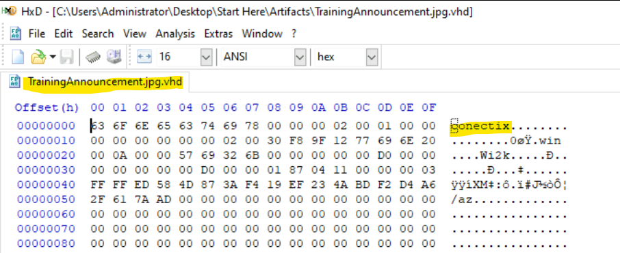

**Q02/** PDF

by opening opening the vhd (mount) we can see the name

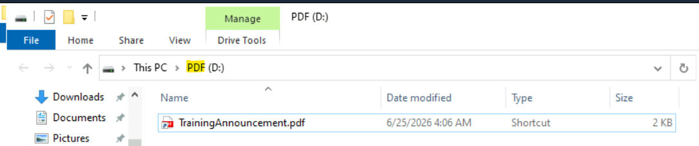

**Q03/** ftp.exe

**Q04/** -s"":_ /_ /j/_ /_ /_ /_ /_ /_

since the pdf is lnk, we will use LEcmd.exe the get both answers

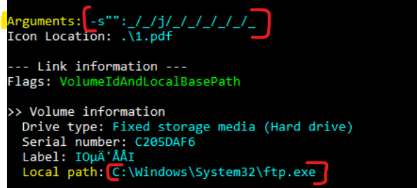

**Q05/** CD147EFE37003399E174951927E5FE727A4481756B116F0204A14A64CC62B059

now we open Authopsy to export all the files of the vhd, 

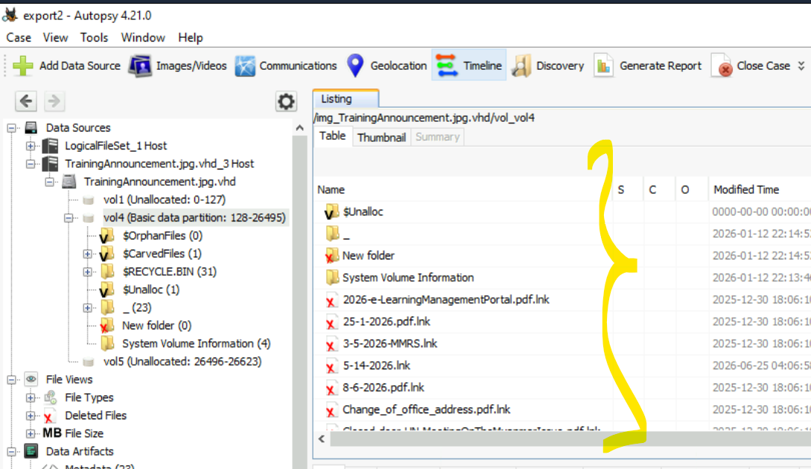

we follow the argument found in question Q4 we find a file that we read,

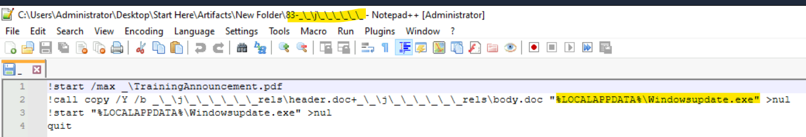

now i lunch the lnk pdf to get the Winup.exe malware file, and got the SHA256 

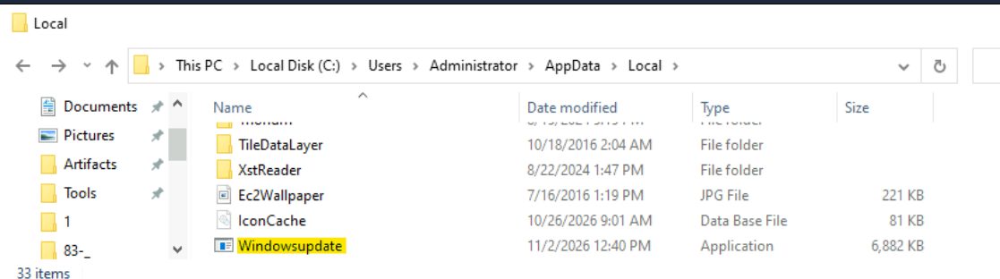

---

### Malware Analysis

now we open the malware with ghidra and export it to C file, and in HxD to use them for the following questions.

i have used also a rapport about this attack https://www.seqrite.com/blog/operation-quicsilver-china-nexus-actor-targets-myanmar-diplomats-via-vhd-delivered-go-backdoor/ 

and help from Claude

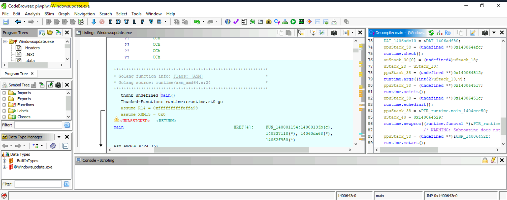

**Q06/** agent/main.go

here i have deducted it, since everyone write the main 

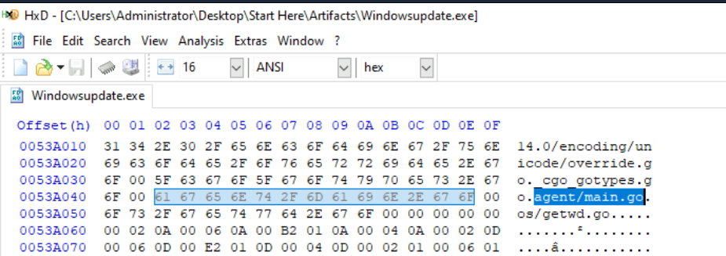

**Q07/** hxxps://regupdate.eamakfu49dc28wa.workers.dev/vere0zme82cad

here got it from rapport and you can verify it in HxD

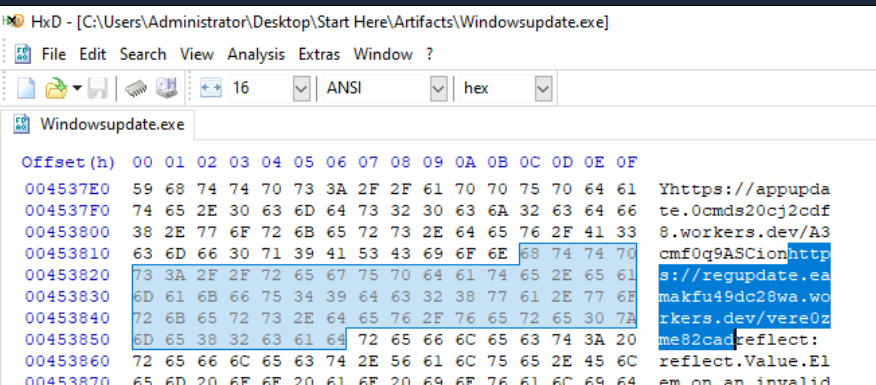

**Q08/** MySecretEncryptionKey2025!@#$%

this one from the rapport

**Q09/** 0x344600

at this point we search the CA with BEGIN and got the stored address 

same time lets copy the CA because we need it for the following question

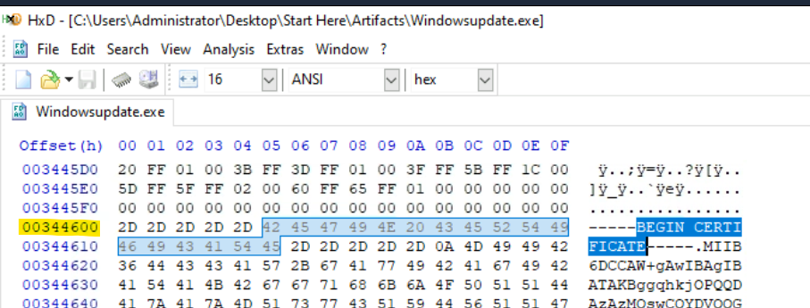

**Q10/** 2025-12-05

i pass the CA throw AI to got the time 

**Q11/** 599

from the rapport the time is between 100-600, and got minus 1 

**Q12/** 0x12A05F200

the heartbeat found in the c script, and conv to hex

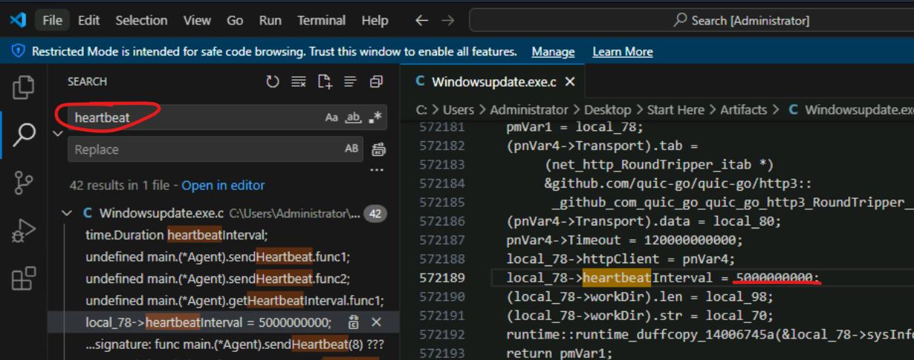

**Q13/** %s/download?task_id=%s&file_name=%s&chunk_num=%d

search by download

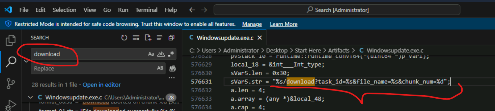

**Q14/** next_chunk

seach by json structure json: found it first

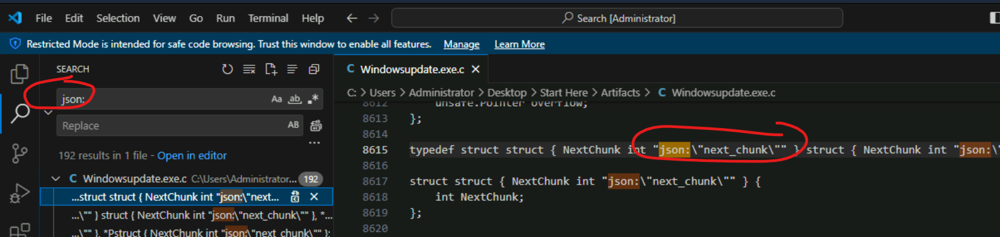

**Q15/** gui_id

same as previous but found it in HxD

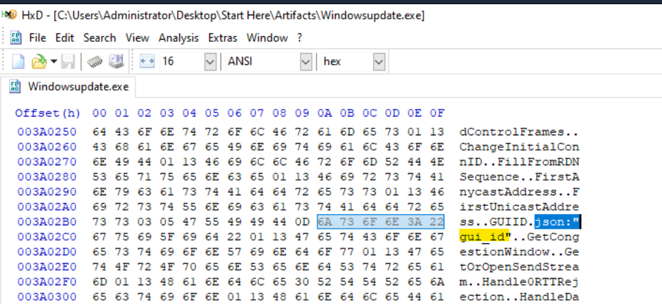

**Q16/** main.(*Agent).resolvePath

searh by resolvepath 

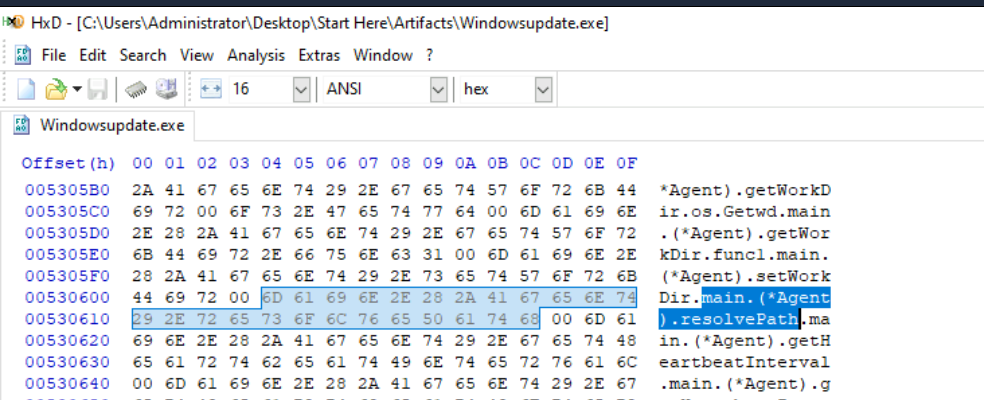

**Q17/** Shell.Application

search by comobject

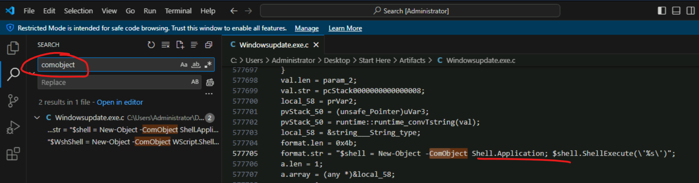

**Q18/** SystemIn.lnk

from rapport

---

### Threat Intelligence

we will use expoeted files from autopsy

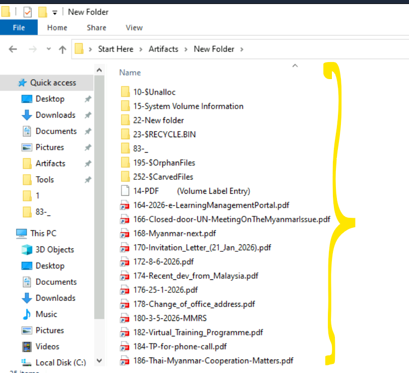

**Q19/** Myanmar

all document point to it

**Q20/** Sumith, Lynn Lynn

with exiftool.exe we check all pdf and fond them

**Q21/** KONICA MINOLTA bizhub 266i

same as previous and found it in Creator Tool : KM_266i, and search for the whole model

**Q22/** Myanmar Institute of Strategic and International Studies

MISIS and a small search 

**Q23/** My Disk

here we used the LEcmd.exe and found that label name , we pass it throw AI to get the exact answer

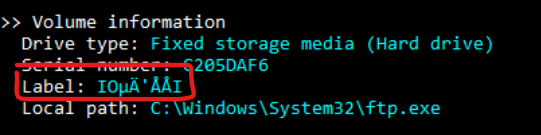

**Q24/** 80:45:dd:e5:91:6e

following the Q23 a little down

**Q25/** dad3fa948af98c55a2029c93999661264c37eb432ef42fdef402326393cfbd0a

here we just continue on q10 to got it

---

### Conclusion
