# Tax Day - BYOVD Lab (Medium)

## Quick Overview

This CyberDefenders lab is in the Endpoint Forensics category, with a touch of malware analysis. The goal is to correlate artifacts from event logs, browser history, and Prefetch, then use static analysis in IDA Pro to rebuild a BYOVD attack chain and the defense evasion tactics around it.

> **BYOVD** = *Bring Your Own Vulnerable Driver*. The attacker drops a legitimate but vulnerable signed driver on the machine and abuses it to get kernel-level access, usually to switch off security tools like antivirus/EDR.

**Tools I used:** MFT Explorer, EvtxECmd, PECmd, Timeline Explorer, IDA

**MITRE ATT&CK Tactics covered:** Resource Development, Persistence, Privilege Escalation, Stealth, Defense Impairment, Command and Control

---

### Initial Access
*MITRE ATT&CK Tactics: Resource Development*

Before starting, I opened the MFT file with MFT Explorer, parsed the event logs with `EvtxECmd.exe`, and opened the result in Timeline Explorer. We'll use all of these for the answers below, so it's worth doing this setup first.

**Q01/** form_w9.msi

**Q03/** bringetax.com

Both answers come from the Chrome history. The user searched for a W-9 tax form and ended up downloading an `.msi` file from a site that isn't an official tax website, which is the starting point of the attack.

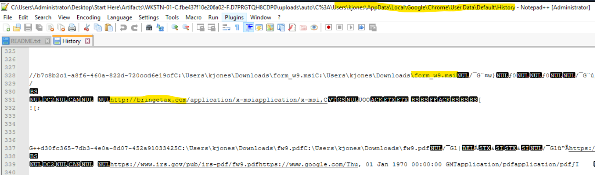

**Q02/** 2026-04-30 18:10

This one is from MFT Explorer. After finding the downloaded file's name in the browser history, I searched for it in the MFT to see exactly when it was created on disk.

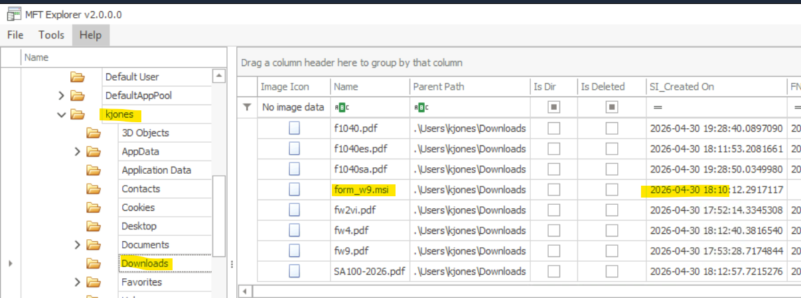

**Q04/** 2026-04-30 18:14

Since the downloaded file was an `.msi`, it gets run through `msiexec.exe`. So I searched for `msiexec` in Prefetch and parsed it with `PECmd.exe`, which gives the execution time of the installer.

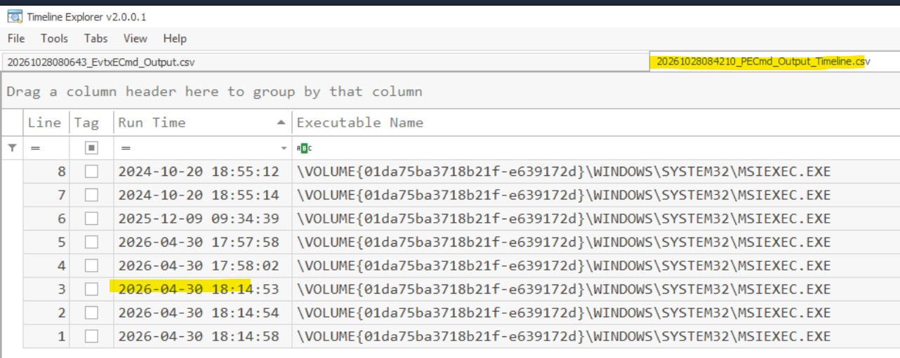

---

### Persistence
*MITRE ATT&CK Tactics: Persistence, Command and Control*

Now that we have the execution time from Q04, we can add it as a filter in Timeline Explorer. This cuts out the noise and shows only what happened right after the installer ran.

**Q05/** AteraAgent

Following that execution time, I found the PowerShell command that installed this RMM (Remote Monitoring and Management) tool. RMM tools are legitimate software, which is exactly why attackers like them: they give remote access and often don't trigger alerts.

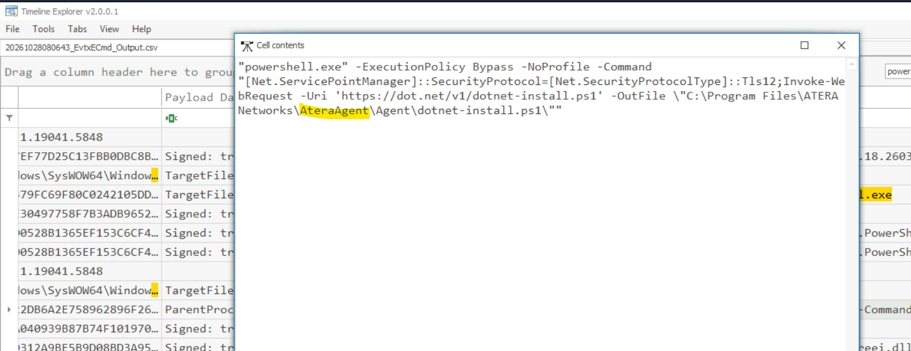

**Q06/** Splashtop® Remote Service

I found the second RMM tool in Program Files, then got its registered service name from Google. Having two remote access tools installed is a good sign the attacker wanted a backup way back in.

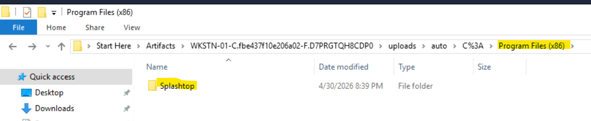

---

### Discovery
*MITRE ATT&CK Tactics: Discovery*

**Q07/** AgentPackageRunCommandInteractive.exe

I searched for `ParentCommandLine` in the parsed logs and looked at which process was opening the CMD. The chain looks like this:

```
AteraAgent.exe → AgentPackageRunCommandInteractive.exe → cmd.exe / powershell.exe → whoami, net, nltest...
```

So the attacker is running commands through the Atera agent, and the discovery commands (`whoami`, `net`, `nltest`) are used to learn who they are on the machine and what the network looks like.

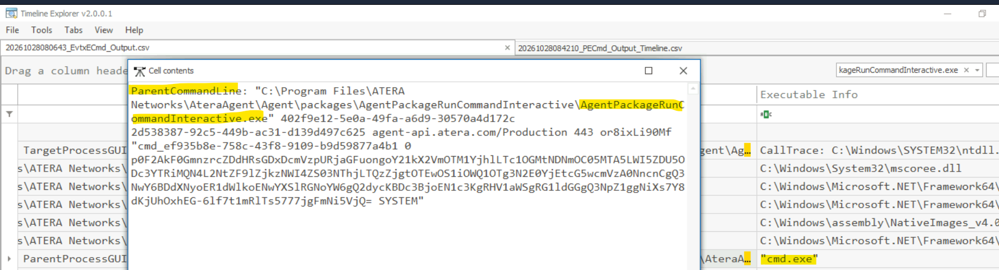

**Q08/** HKLM\System\CurrentControlSet\Control\Lsa

Found by searching for the registry query command (`reg query`) in the logs. This registry key holds LSA (Local Security Authority) settings, so querying it right before a credential attack makes sense.

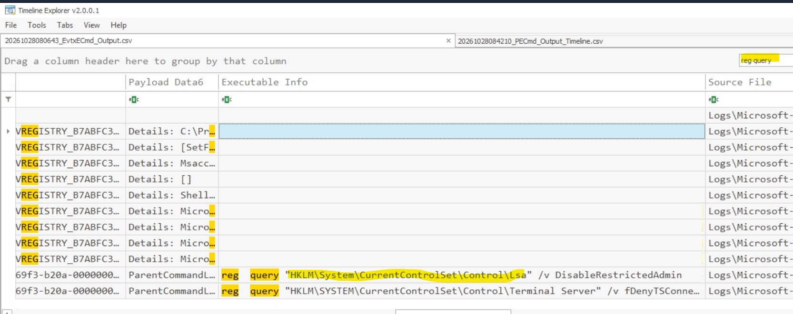

---

### Credential Access
*MITRE ATT&CK Tactics: Credential Access*

**Q09/** 2026-04-30 19:32

I found a malware detection log mentioning `lsass`. This is the first sign the attacker tried to touch LSASS (the process that holds credentials in memory), and it got detected.

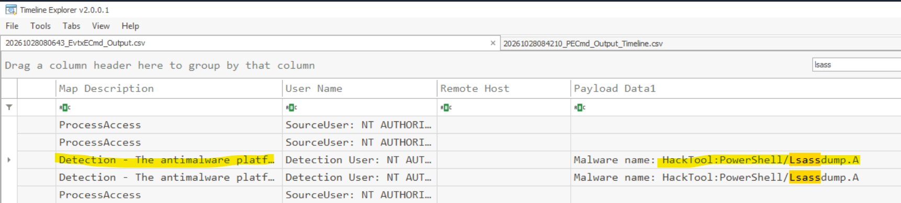

---

### Stealth & Defense Impairment
*MITRE ATT&CK Tactics: Privilege Escalation, Stealth, Defense Impairment*

After the LSASS attempt got detected, the attacker's next move is to get rid of the antivirus.

**Q10/** sc.exe stop WinDefend

A quick Google search for the command. It uses `sc.exe` (the Windows service controller) to stop the `WinDefend` service, which is Windows Defender.

**Q11/** HWAuidoOs2Ec.sys, kd.exe

Found in the Roaming folder. A `.sys` file is a driver, and a driver sitting in a user's Roaming folder is suspicious by itself, since legitimate drivers don't normally live there.

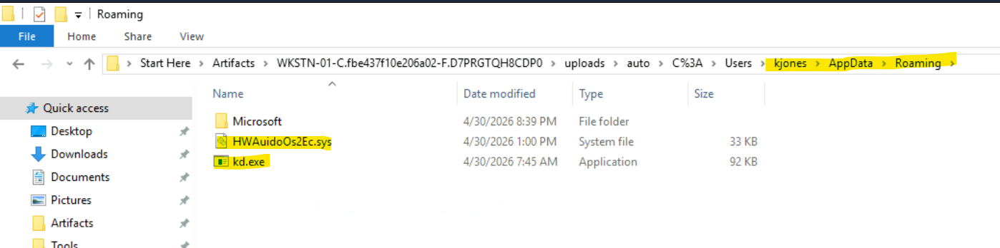

**Q12/** HwAudio

Found in the log showing a new service being installed. Installing the driver as a service is how the attacker loads it into the kernel.

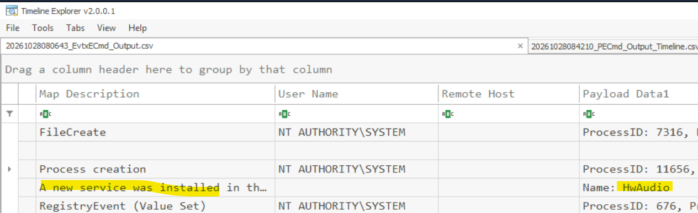

**Q13/** 2026-04-30 19:35

Found in the event logs, and it can also be double-checked with Prefetch. Both give the time the attacker's tool ran.

**Q14/** MsMpEng.exe

**Q15/** 0x2248DC

Both of these were found in IDA, in the `main` function. I opened the sample in IDA, went straight to `main`, and read through it: the process name it targets and the value it uses are both visible there. `MsMpEng.exe` is the main Windows Defender process, so this is the BYOVD part: using the vulnerable driver to kill Defender.

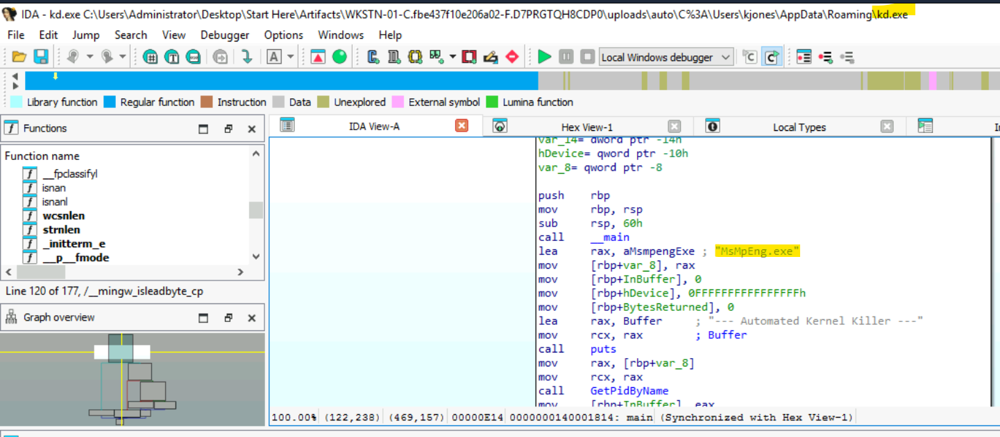

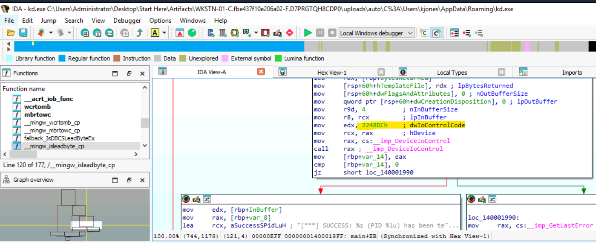

---

### Credential Access (LSASS Dump)
*MITRE ATT&CK Tactics: Credential Access*

**Q16/** 2026-04-30 19:36

For the last one, I searched for `lsass.dmp`. With Defender out of the way, the attacker could finally dump LSASS memory to disk, and the timestamp of that file gives the answer.

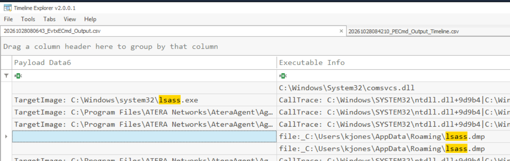

---

## Conclusion

This was a nice lab, and my first time seeing a BYOVD attack in an investigation. The story is easy to follow once you put it in order: a fake tax form installer, two remote access tools for persistence, some discovery commands, then Defender gets stopped, a vulnerable driver gets installed to kill `MsMpEng.exe`, and finally LSASS gets dumped for credentials.

My favorite part was combining the different artifacts (Chrome history, MFT, Prefetch, event logs) with IDA for the driver part. Using the time from one artifact as a filter in Timeline Explorer saved a lot of searching.

Main lesson: attackers don't always bring malware. Here they used legitimate RMM tools and a legitimate (but vulnerable) driver, so the logs and Prefetch were where the real story was.
